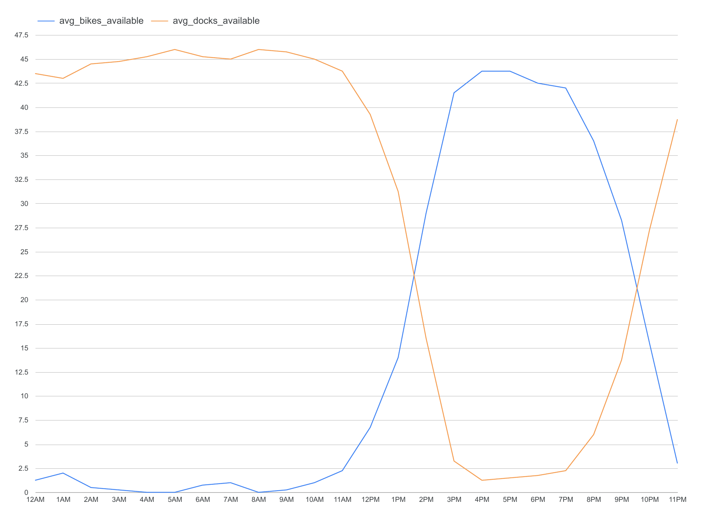

# DivvyAI: a short demonstration

## What the project does

Every 15 minutes, Cloud Scheduler launches a containerized Python collector
on Cloud Run Jobs. It fetches Chicago Divvy station information and status,
archives the original responses in Cloud Storage, and batch-loads station
records into BigQuery.

dbt views organize those records into station snapshots, hourly sampled
availability and collection intervals.

## 1. Demonstrate collection locally

From the repository root:

```bash
uv run python -m divvyai.local
```

This uses synthetic fixtures and makes no network requests.

Expected output includes:

- Mode: fixture (synthetic data).
- Four raw records: two stations across two feeds.
- A ZIP archive under data/demo/raw/.
- A JSONL load file under data/demo/warehouse/.

The ZIP preserves original inputs for inspection and replay.
The JSONL represents individual station records for warehouse loading.

## 2. Explain the deployed cloud path

```text
Cloud Scheduler
      |
Cloud Run Job -> Divvy feeds
      |
      +-> Cloud Storage: original response archive
      |
      +-> BigQuery: raw station records
                        |
                     dbt views
                        |
              station snapshots and hourly averages
```

Recorded evidence from October 18, 2026, UTC:

Execution divvyai-collector-4mhvf completed a BigQuery load at 17:02:00.340.
Its completion receipt reported 4,148 raw records.

Those are records across two feeds, not 4,148 unique stations.
This is recorded deployment evidence, not a live result from the offline demo.

## 3. Explain the analytics

The staging views extract typed fields from raw JSON.
The snapshot view joins station information and status from the same capture.
The hourly mart groups observed counts by station and UTC hour.

One recorded October 18 result for station
03a1610c-3ba0-4b85-b512-bc26791cb7ee at 22:00 UTC contained:

- Three snapshots.
- Mean bikes available: 4.
- Mean docks available: 10.

These are averages of collected observations, not continuous measurements.

## 4. Show the recorded availability chart



[Open the PDF](assets/hourly_station_availability_2026-10-21.pdf) or
[inspect the 24-row CSV](assets/hourly_station_availability_2026-10-21.csv).
These saved artifacts can be viewed without cloud access or new queries.

This Data Studio report shows one station on October 21, 2026, UTC:

- Station ID: a3ad8072-a135-11e9-9cda-0a87ae2ba916.
- 24 hourly rows, from 00:00 through 23:00 UTC.
- Four station-status observations per hour, for 96 observations in total.
- Mean bikes available and mean docks available for each hour.

For example, at 00:00 UTC the hourly averages were 1.25 bikes and 43.5 docks.
At 16:00 UTC they were 43.75 bikes and 1.25 docks. Fractional values are
averages of the four observations, not fractional physical bikes or docks.

The station was selected because its hourly bike averages varied. It is an
illustration of one station, not a summary of the entire Divvy network.
The CSV export groups the saved raw station-status records by UTC hour using
the same hourly averaging calculation described above. It was uploaded to
Data Studio manually; the report is not directly connected to the dbt views
and does not refresh automatically.

The lines connect observed hourly averages. They do not establish continuous
availability between samples or count trips, and they are not predictions.

## What is not implemented

The recorded chart uses manual CSV refresh. Automatic dashboard refresh and
prediction are not implemented.
Collection is scheduled, but gap-free delivery is not guaranteed.
dbt checks are manually executed.

One missed collection was investigated and traced to container-image
authentication failure before Python started. The underlying authentication
cause remains unconfirmed.

See PROJECT_STATE.md and INCIDENT_2026-10-18_IMAGE_IMPORT.md for evidence.
